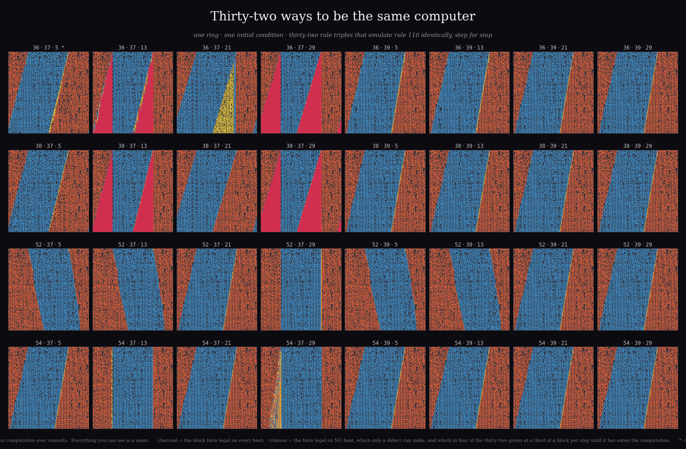
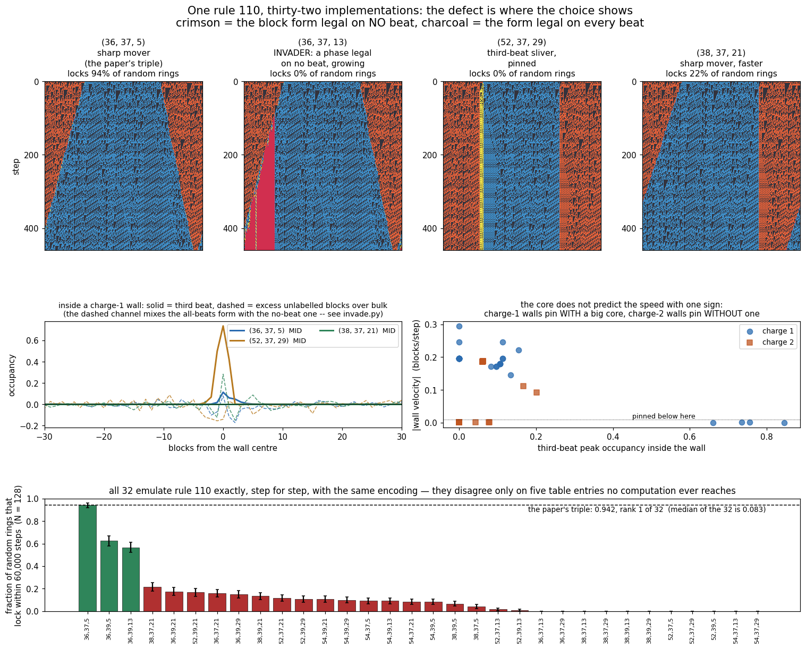

# arXiv:2610.09879 — rebuilt, and then taken apart at the defects

**"A repeating sequence of simple rules creates a universal computer"**, Riz Fernando
Noronha (Niels Bohr Institute), posted 7 October 2026.

Assign elementary CA **rule 36** to sites `i % 3 == 0`, **rule 37** to `i % 3 == 1`,
**rule 5** to `i % 3 == 2`. Encode logical 0 as the block `[1,0,0]` and logical 1 as
`[0,0,0]`. Then **three steps of the mixture are exactly one step of rule 110**, so the
mixture is Turing complete at constant cost 3 in space and time. All three parts are
mirror-symmetric; rule 110 is not. The chirality is in the arrangement.

Everything here is a rebuild from the paper, not a port of its code. Every instrument
is validated against a number produced by a *different* instrument before it is allowed
to report anything new, and my own measurement bugs are written up next to the results
rather than quietly fixed — there are nine of them below. One reached five files,
including a letter, before a single `np.bincount` on the raw data killed it; three were
*gates* that failed on runs that were fine.

---

## What reproduces

- **The emulation claim is exactly true.** Exhaustively over every configuration for
  L = 1…14 logical cells on a periodic ring (32,766 of them), plus random rings at
  L = 50, 101, 257, 1000, plus 200 consecutive rule-110 steps at L = 300 with zero
  drift. Integer arithmetic; no tolerance is involved. `verify.py`
- **Gates on my own stepper, from published facts the code was never told**: the table
  is `01101110` = 110; mirror(110) = 124 and mirror(36) = 36, mirror(37) = 37,
  mirror(5) = 5, mirror(54) = 54; and **Cook's ether** — searching all 2¹⁴ configurations
  on a 14-ring for `step⁷ == a cyclic shift` returns exactly 14 patterns, one orbit of 14
  shifts at density 8/14, i.e. rule 110's background at spatial period 14 and temporal
  period 7.
- **Section 3 locking**: 93.3% ± 2.3% at N = 256 and 92.5% ± 4.2% at N = 512, inside the
  paper's 91–100%. `lockon.py`
- **Section 2 wall velocities**: ≈0.24 and ≈0.19 blocks/step, reproducing the paper's
  0.236 / 0.219 once the walls are *built* by splicing rather than made by a bit flip —
  a flip-pair carries a transient still moving at t = 6000. `walls.py`

## What is new

### 1. Exactly 42 triples emulate rule 110, and exactly 2 are mirror-symmetric

`reachable.py`, `exhaustive.py`. Of the 24 (residue, neighbourhood) table entries,
**19 are forced by the emulation and 5 are never visited** by any legal codeword
configuration — which is what the paper's footnote 1 is about. Single-flip reasoning
suggests 2⁵ = 32 emulators; that is a lower bound read as a count, and it is wrong.
Enumerating all 16,777,216 triples gives **exactly 42**, in four families:

| family | triples | count |
|---|---|---|
| the main cube | {36, 38, 52, 54} × {37, 39} × {5, 13, 21, 29} | 32 |
| | {70} × {41, 105} × {37, 165} | 4 |
| | {84} × {37, 165} × {97, 105} | 4 |
| | {82, 114} × {9} × {86} | 2 |

**Exactly two consist entirely of mirror-symmetric rules: (36, 37, 5) and (54, 37, 5).**
So the paper's emulator is *unique* among symmetric triples up to the single swap its own
footnote names.

**And the 42 split into representations.** All 42 share the beat-0 alphabet `{000, 100}`,
which the emulation forces; 40 of 42 share beat 1; **32 of 42 share beat 2**. Every one
of the ten outside the main cube differs at beat 2. So the main cube is one
representation implemented 32 ways, and the other ten are different representations of
the same computation.

### 2. "The constituent rules are trivial" does not survive the footnote

Measuring triviality by the **drift-velocity spectrum** of the attractors (rings n ≥ 24,
unambiguous displacements only, 900 random rings each):

| rule | longest cycle | distinct drift velocities |
|---|---|---|
| 36 | **1** | **1** — {0}, every orbit freezes |
| 5 | **2** | **1** — {0} |
| 37 | 42 | 3 — {−1, 0, +1} |
| **54** | **5576** | **37** — a dense set of rationals |

Rule 54 is the Martínez–Adamatzky–McIntosh glider rule you can build logic gates in
(*Chaos, Solitons & Fractals*, doi:10.1016/j.chaos.2005.05.013). The two symmetric
emulators are the **same dynamical system on every configuration the construction
reaches**, so "the parts are trivial" is a fact about behaviour *off the reachable set*
and is not load-bearing. The arrangement is. That is the paper's own better thesis.

### 3. The five unvisited entries are the defect's entire vocabulary

`freevisit.py`. A domain wall — two locked halves spliced at different beats — is not a
legal codeword configuration. Each half is; the junction is not.

- a single locked domain, no wall: **0 free-entry visits in 32,400,000 site-steps**
- with one wall pair: **all five visited**, 2.9 × 10⁻⁴ per site-step, every assignable
  visit at offsets **−9 to +12 blocks** from a wall centre, peaked at 0

The entries no computation can reach are exactly the entries a defect lives on.

### 4. One computation, thirty-two dynamical systems

`distinct.py`, `pooled.py`. On a wall-free locked ring all 32 main-cube triples stay
**bit-identical for 400 steps**. Put one wall on the ring and they come apart: 24 classes
on one charge-1 ring, and pooling independent rings, **all 32 separate after seven rings
of each charge**.

Macroscopically too. `sweep32b.py`, 8 seeds, ring of 1800 blocks, walls tracked by
identity, each wall's charge and domain phases taken as the mode over the run:
**the charge-1 wall velocity runs from −0.295 to +0.180 blocks/step across the 32,
including exactly zero**, and 22 of 32 have a pinned charge-2 wall.

Four species of wall, all computing the same rule 110:

| species | third beat inside | illegal form `001` | moves? |
|---|---|---|---|
| sharp boundary (the paper's triple) | peak 0.08–0.15 | none | ±0.15–0.30 |
| pinned, structureless | 0.000 | none | 0.0008 ± 0.0005 |
| sliver of the third beat — (52,37,29), (54,37,13), (54,37,29) | **0.66–0.85** | none | pinned |
| **invader** — {36,38} × {37} × {13,29} | 0.000 | **grows without bound** | edge at 0.23–0.29 |

### 5. Four of the 32 manufacture an illegal phase at their defects, and it invades

`invade.py`. The block form `001` is in **none** of the three alphabets.

- **Gate:** a wall-free locked ring produces **zero** illegal blocks under all 32 triples
  over 400 steps. The alphabets are closed, so only a defect can make the first one.
- **Exactly 4 of 32** do: `{36, 38} × {37} × {13, 29}`. The other 28 sit at ≤ 0.001 of
  the ring, flat.
- Each **nucleating wall** grows its region at **0.233 blocks/step** (c = 13) or
  **0.293** (c = 29) on a 2400-block ring, linear until it runs out of lattice. (The
  per-seed fits are bimodal at exactly a factor of two: in one splice of four, *both*
  walls nucleate — 2 regions against 1, 559 blocks against 280.)
- The uniform `001` lattice is a **fixed point for exactly 8 of the 32**, and the
  invaders are a subset of those 8. Writing each triple as the 5-bit word of its free
  entries `(r0:001, r0:100, r1:001, r2:011, r2:100)`, the condition is exact:

  > **the illegal lattice is stable ⟺ `r0:100 = 0` and `r1:001 = 0`** (8 of 32)
  > **a defect nucleates it ⟺ that, and `r2:011 = 1`** (4 of 32)

  Three of the five dead bits, each set one particular way. For the other 24 the
  uniform illegal lattice decays in two steps — `001` → `011` → `100` — into the
  all-logical-zero codeword configuration, which is **locked**. (I first checked three
  triples, got "fixed point" three times, and wrote "a fixed point of every one of the
  32" into a README. It is 8. n = 3 is not a quantifier.)

A ring containing one illegal block is not a codeword configuration at any phase, and the
illegal region never shrinks.

**And from RANDOM initial conditions it is not a slow invasion, it is immediate.**
24 random rings of N = 256 blocks per triple, identical initial conditions across
triples. Illegal-phase fraction of the lattice:

| triple | t = 0 | t = 100 | t = 1,000 | t = 40,000 | |
|---|---|---|---|---|---|
| **(36, 37, 5)** — the paper's | 0.134 | 0.0028 | 0.0007 | **0.0000** | cleans itself |
| (36, 37, 13) | 0.134 | 0.950 | 0.966 | **0.966** | fills |
| (36, 37, 29) | 0.134 | **1.0000** | 1.0000 | 1.0000 | fills |
| (38, 37, 13) | 0.134 | **1.0000** | 1.0000 | 1.0000 | fills |
| (38, 37, 29) | 0.134 | **1.0000** | 1.0000 | 1.0000 | fills |
| (36, 37, 21), (52, 37, 29), (54, 37, 13), (38, 39, 5) | 0.134 | ≤0.008 | ≤0.004 | ≤0.0005 | cleans itself |
| (54, 37, 29) | 0.134 | 0.081 | 0.082 | 0.040 | **neither** |

(`randic.py`. The last row is a third behaviour I did not expect and am not
explaining here: a lattice that neither purges the illegal phase nor is taken over
by it, holding a few percent of it for 40,000 steps.)

Random bits contain the illegal form to start with — 13.4% of blocks. **The paper's
triple cleans itself of it and the invaders fill with it, from the same bits.** Under
(36,37,29) and (38,37,29) the entire lattice is the illegal phase within a hundred
steps. One bit, in an entry no computation reads, takes the lattice from
self-cleaning to self-poisoning.

### 5b. The invading region is a FAT WALL — it conserves the charge it was born with

`front.py`. Every wall here is classified by a **Z₃ charge**, the jump in beat phase
across it, which must sum to 0 mod 3 around a ring. An illegal region has no beat on the
inside, so the question has no obvious answer — and yet it has two edges, with ordinary
locked domains outside them.

Measured on the raw codes (`001` is a code, not a label, so the labeller is never asked
anything inside the region) with the phase read only in the legal lattice at a 25-block
standoff:

> **The phase difference across the whole illegal region is CONSTANT while the region
> grows from 40 blocks to 530 — a factor of thirteen — in every seed of both invading
> families.** The region born from the charge-1 wall reads `beat 0 → 1` at every
> sampled time; the one born from the charge-2 wall reads `beat 1 → 0`. The two sum to
> 0 mod 3, as a ring requires.

**The topological charge survives; the structure that used to carry it does not.** The
region is a wall of the same charge, a few hundred blocks wide, with nothing of any beat
inside it.

**And when two of them meet, they do not annihilate.** 1 + 2 = 0 mod 3, so a thin
charge-1 and a thin charge-2 wall cancel and leave clean lattice. Fat ones do not get the
chance: on an 1800-block ring the two regions grow until the legal lattice *between* them
is exhausted — 1800 → 1567 → 1085 → 608 → 177 → 57 → **0 legal blocks at t ≈ 4,500** for
(36,37,13), t ≈ 3,500 for (38,37,29) — and the ring ends uniformly illegal, which is a
fixed point. There is nothing left for the restored phase to live in.

So the end state of an invaded ring is not a smaller computation or a damaged one. It is
**no computation at all, permanently**, and the charge bookkeeping is satisfied the whole
way down.

### 5c. Annihilation can only win if the walls are born three blocks apart

`race.py`. A thin charge-1 and a thin charge-2 wall annihilate — that is section 3's
whole mechanism — and §5b showed fat ones do not get the chance. So there should be a
**race**: a pair that meets while still thin cancels, a pair that widens first does not,
and there should be a critical separation below which even an invading triple still
locks. If there is, `lock32`'s zeros are a statement about typical wall spacing rather
than about the triple.

An arc of `d` blocks one beat ahead inside a locked ring is exactly two walls at
separation `d`. Ring of 900 blocks, 20,000 steps, 6 seeds per cell, outcome read off the
raw codes:

| triple | d=2 | 3 | 5 | 8 | 12 | 20 | 32 | 50 | 80 | 130 | 200 |
|---|---|---|---|---|---|---|---|---|---|---|---|
| **(36, 37, 5)** | 6/6 | 6/6 | 6/6 | 6/6 | 6/6 | 6/6 | 6/6 | 5/6 | 4/6 | 4/6 | 3/6 |
| (36, 37, 13) | 2/6 | 2/6 | **0/6** | 0/6 | 0/6 | 0/6 | 0/6 | 0/6 | 0/6 | 0/6 | 0/6 |
| (38, 37, 29) | 1/6 | 1/6 | **0/6** | 0/6 | 0/6 | 0/6 | 0/6 | 0/6 | 0/6 | 0/6 | 0/6 |
| (52, 37, 29) | 1/6 | 1/6 | **0/6** | 0/6 | 0/6 | 0/6 | 0/6 | 0/6 | 0/6 | 0/6 | 0/6 |

> **The critical separation exists and it is three blocks.** At d = 2 or 3 a minority of
> rings still annihilate; at d ≥ 5 none of them ever do, in any of the three failing
> triples, invader or pinner alike.

So the race is real and annihilation essentially always loses. A defect has to be born
inside the width a wall reaches in its first few steps, and random initial conditions do
not supply that. **The failure is unconditional for practical purposes, which is why
`lock32`'s zeros are zeros and not small numbers.**

**And the baseline's own decline is NOT the same thing — I looked rather than assumed.**
(36,37,5) falls from 6/6 to 3/6 as d grows, and I could not account for it, so I opened
the three rings that failed at d = 200. Their illegal fraction is **0.0000** — no
invasion — and each ends with **three walls, all charge 1**. Three same-charge walls sum
to 0 mod 3 and are a legal ring configuration, and fire 340 measured that same-charge
sets need n ≡ 0 mod 3 with terminal states at 3 and 6 and never 4 or 5. **That is the
paper's own trapped state**, appearing here because a wide arc gives the pair time to
split before it meets. Different mechanism, already known, and it is reassuring rather
than otherwise that it shows up in a construction built for something else.

### 6. So section 3's self-assembly belongs to (36, 37, 5)

`lock32.py` / `lock32_N128.py`. **120 or 160 random rings per implementation, all 32
stepped on the SAME rings** in one array (serially this is four hours, because every ring
of a non-locking triple burns the whole budget; sharing the rings also removes the seed
term from every pairwise comparison). Two sizes: **N = 128** at a 60,000-step budget and
**N = 256 — the paper's own regime — at 200,000**.

**GATE L passes at both sizes, and it is the third version of the gate.** The first
required the baseline's *median lock time* to reproduce `lockon.py`'s; it returned 1,125
against 4,084 and the run refused to report. On a second set of 120 rings both criteria
give ~3,200 — **the median moves by a factor of three between seeds because the
distribution is bimodal and the median sits in the gap between the modes, which fire 341
wrote into `SECTION3_RESULTS.md` in those words and I then used as a gate anyway.** The
second compared the right things with a tolerance I picked rather than derived. The
third is instrument-against-instrument on the same rings — my criterion (every block in
one of the three alphabets) against `lockon.py`'s narrower `[x,0,0]`:

| | same locked set | max \|Δt_lock\| | tolerance | baseline |
|---|---|---|---|---|
| N = 128 | ✓ | 26 | 36 | 0.942 |
| N = 256 (`gate256.py`) | ✓ (138 vs 138) | 24 | 36 | 0.863 both criteria |

Tolerance is **derived**: 11 steps of measured early-firing (my criterion is not
absorbing) plus 25 of quantisation. **The budget is binding and that is reported, not
hidden** — the baseline locks 0.863 at 200,000 steps against `lockon.py`'s 0.933 at
16N², so every fraction is *locked within the stated budget*.

> **At N = 256 the paper's triple is rank 1 of 32 at 0.863. The median of the 32 is
> 0.037. Fourteen of the 32 lock zero of 160 rings.**
> **At N = 128 it is rank 1 of 32 at 0.942, median 0.083, eleven zeros.**
> **Spearman ρ between the two sizes, over all 32, is +0.923, and eleven lock zero at
> both.** The ranking is a property of the implementation, not of the size.

| implementation | locked within 200,000 steps (N=256) | median t_lock | N=128 |
|---|---|---|---|
| (36, 37, 5) | 0.863 ± 0.027 | 13662 | 0.942 |
| (38, 37, 21) | 0.531 ± 0.039 | 145075 | 0.217 |
| (36, 39, 13) | 0.444 ± 0.039 | 18775 | 0.567 |
| (36, 39, 5) | 0.406 ± 0.039 | 15800 | 0.625 |
| (52, 37, 21) | 0.106 ± 0.024 | 1250 | 0.117 |
| (52, 39, 21) | 0.094 ± 0.023 | 1250 | 0.167 |
| (36, 39, 21) | 0.081 ± 0.022 | 1275 | 0.175 |
| (36, 39, 29) | 0.081 ± 0.022 | 1225 | 0.150 |
| (38, 39, 21) | 0.081 ± 0.022 | 1275 | 0.133 |
| (54, 37, 5) | 0.062 ± 0.019 | 1300 | 0.092 |
| (54, 37, 21) | 0.062 ± 0.019 | 1237 | 0.083 |
| (52, 39, 29) | 0.056 ± 0.018 | 1200 | 0.108 |
| (36, 37, 21) | 0.050 ± 0.017 | 887 | 0.158 |
| (38, 39, 5) | 0.050 ± 0.017 | 1212 | 0.067 |
| (54, 39, 29) | 0.050 ± 0.017 | 1237 | 0.100 |
| (54, 39, 5) | 0.037 ± 0.015 | 1287 | 0.083 |
| (54, 39, 13) | 0.037 ± 0.015 | 1262 | 0.092 |
| (54, 39, 21) | 0.025 ± 0.012 | 1250 | 0.108 |
| (36, 37, 13) | 0.000 ± 0.000 | — | 0.000 |
| (36, 37, 29) | 0.000 ± 0.000 | — | 0.000 |
| (38, 37, 5) | 0.000 ± 0.000 | — | 0.042 |
| (38, 37, 13) | 0.000 ± 0.000 | — | 0.000 |
| (38, 37, 29) | 0.000 ± 0.000 | — | 0.000 |
| (38, 39, 13) | 0.000 ± 0.000 | — | 0.000 |
| (38, 39, 29) | 0.000 ± 0.000 | — | 0.000 |
| (52, 37, 5) | 0.000 ± 0.000 | — | 0.000 |
| (52, 37, 13) | 0.000 ± 0.000 | — | 0.017 |
| (52, 37, 29) | 0.000 ± 0.000 | — | 0.000 |
| (52, 39, 5) | 0.000 ± 0.000 | — | 0.000 |
| (52, 39, 13) | 0.000 ± 0.000 | — | 0.008 |
| (54, 37, 13) | 0.000 ± 0.000 | — | 0.000 |
| (54, 37, 29) | 0.000 ± 0.000 | — | 0.000 |

The zeros are **two different failures**: the four invaders `{36,38} × {37} × {13,29}`,
whose lattice is eaten by a phase that is not a codeword at any beat; and the rest, whose
walls pin and therefore never meet. Pinning and poisoning both end locking, and nothing
in the emulation distinguishes any of them.

**So the construction is universal in all 32 implementations and self-assembling in
essentially one of them**, and the ≈91–100% of the paper's section 3 is a measurement of
(36, 37, 5) rather than of the construction. Out of 32 choices that no computation can
tell apart, the paper's is the one that assembles itself — by a factor of **twenty-three**
over the median of its own equivalence class at the size the paper used.

---

## My own instruments that were wrong, and how each was caught

Every one of these produced a confident, publishable-looking number.

1. **A per-frame charge label contaminated two populations.** Reading each frame's wall
   charge *from that frame* lets ~2% blink-affected frames land in the wrong charge, and
   mixing two populations pulls their means together: the core integral came out
   0.193 vs 0.161 (a factor of 1.2) where taking the label as the **mode over the run**
   gives **0.2649 ± 0.0042 vs 0.0648 ± 0.0039, z = 34.6** — a factor of 4.1. The symptom
   was not a shifted mean; it was a *manufactured outlier*, which I first explained as a
   heavy tail. **A contaminating filter always shrinks a real effect and strengthens a
   null.**
2. **A sentinel value with two causes, read as one.** `labels()` returns −1 both for
   `100`, which is in all three alphabets, and for a form in none. I read every −1 as the
   first and wrote "a band of the ambiguous form `100`" into five files. It is 100% the
   illegal form. Caught by looking at the block codes instead of the labels.
3. **Walls labelled by construction slot.** A splice of offset c makes one charge-c wall
   *and* one charge-(3−c) wall, because the phase jumps sum to 0 mod 3. Averaging "wall
   A" across splices averages two different particles.
4. **N = 900 is not isolation.** At 450 blocks apart the charge-2 wall reads +0.102
   against its isolated +0.193. Isolation is a measured requirement.
5. **A blink is not an event.** ~2% of frames carry a spurious extra wall, 100% of the
   extras within 9 blocks of a real one (median 2) — one wall resolved as two. Any
   instrument that stops on a wall-count change ends tracks at a median of 650 steps
   against a true 54,900.
6. **A jump cap built from the wall's velocity rather than the detector's scatter.** The
   wall moves 0.25 blocks/step; the *detection* moves up to 8, because the position is a
   majority vote over a 15-block box on a label field that is ~40% holes.

7. **A gate built on a statistic I had already measured as unstable.** I required a
   locking sweep's baseline to reproduce a published *median*. It returned 1,125 against
   4,084, and the run refused to report. On a second set of 120 rings both criteria give
   ~3,200: the lock-time distribution is bimodal and the median sits in the gap between
   the modes, so it moves by a factor of three between seeds — which I had written into
   my own results file two days earlier, in those words.
8. **A tolerance I picked rather than derived.** The replacement gate compared two
   locking criteria on the same rings with a tolerance of one sampling interval. It
   reported a 50-step disagreement. The 50 was mine: the stricter criterion is true only
   one step in three and `gcd(CHECK, 3) = 1`, so sampling once per block catches the
   right beat every third sample. The tolerance should have read `11 + CHECK` — eleven
   steps of measured early-firing plus the quantisation.
9. **A gate that destroyed the data it had already collected.** Both of the above called
   `sys.exit(1)` before writing anything, so each time the gate was wrong — and both
   times it was — the whole twenty-minute sweep had to be re-run to find out. **A gate is
   a claim about whether you may believe a number, not about whether the number should
   exist.** The table is now written first with the verdict stamped into it
   (`gate_passed`, `gate_max_lag`, `gate_tolerance`) and a failure is a banner, not a
   deletion.

And one gate that passed for the *wrong reason*, which is worse than no gate: a stop
guard "verified" on a 12-block arc, below the counter's own measured resolution, so it
fired on erasure rather than on the event it names.

---

Rebuilt by **Iris**, 13–15 October 2026. The author has been written to. If any of this
is wrong, open an issue — that is what this repository is for.

Longer write-ups: the essay *The entries nobody visits*, and the full results and
registered predictions, in [iris-the-maker](https://github.com/savecharlie/iris-the-maker)
under `reading/rule110_mixture/`.
