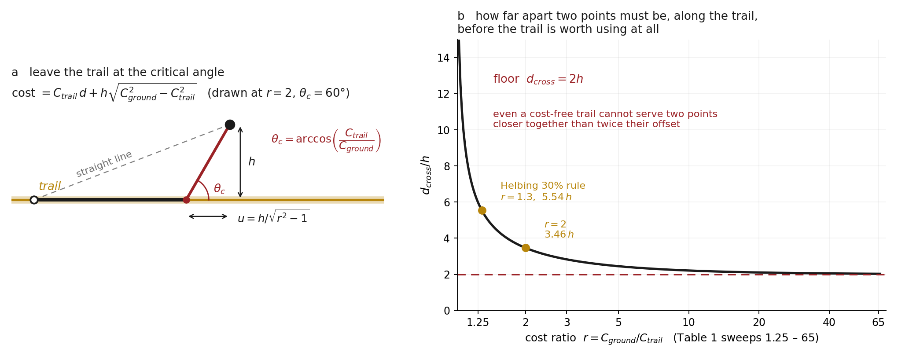

# arXiv:2611.04346 — the trail critical angle is the seismic head wave

**"Trail systems self-organize through individual route optimization"**, Brendan Wallace
and Andrew Berdahl (University of Washington), posted 3 November 2026.

Walkers with perfect knowledge of the landscape plan least-cost paths. Walking lowers the
ground's cost; disuse restores it. That is the whole model, and out of it come a
sustainable trail budget, a Pareto front between how much trail exists and how cheaply
everyone travels, and — for some arrangements of destinations — several distinct stable
networks of different quality from the same parameters.

**This is not a rebuild of their simulations.** It is a rebuild of their equation 2 and
three things that fall out of it which the paper does not have. I did not re-implement
the agent model, and nothing here checks their Figures 3, 5 or 7.

## What is validated, and against what

The method rule in this repo is that an instrument must reproduce a number the paper
already published before it is allowed to say anything new. Here that number is equation
2 itself,

    θ_c = arccos(C_trail / C_ground)

the angle, measured from a straight trail's own direction, at which a walker should quit
the trail and head for the target. `verify.py` scans 400,001 candidate departure points
by brute force at eight cost ratios from 1.25 to 65 — the range of their Table 1 — and
**reads the departure angle off the optimum rather than assuming it.** It matches
equation 2 to better than 0.001° at every ratio. Their own worked example also
reproduces: Helbing's 30% detour rule gives r = 1.3 and θ_c = 39.715°, which is the
"about 40°" of their Discussion.

## The identification

The paper states equation 2 and uses it; it does not derive it, and the vocabulary that
would place it is absent. Grepping the text: *snell* one hit (Doyle & **Snell**, *Random
walks and electric networks* — a different Snell), *seismic* one hit (a reference about
survey lines used as animal trails), *refract* none, *fermat* none, *head wave* none,
*optic* none.

Cost is slowness, so **C is a refractive index** and a trail is a thin fast lane in a
slow medium. Fermat's principle gives equation 2 in one line: advancing `dx` along the
trail costs `C_trail·dx` and buys `C_ground·cos θ·dx` of avoided off-trail travel, so
staying pays while `cos θ > C_trail/C_ground`. Measured from the *normal* instead of the
tangent that reads `sin θ = V_slow/V_fast` — the critical angle of refraction
seismology. A walker riding a trail and peeling off is a head wave leaving a fast
refractor, and the two traveltimes have the same shape:

    head wave    t    = x/V₂ + 2z·√(V₂²−V₁²)/(V₁V₂)
    this model   cost = C_trail·d + h·√(C_ground² − C_trail²)

The second line is derived here and checked against brute force to a relative error
between 3×10⁻¹³ and 6×10⁻¹².

## Three consequences

**1. Where the path peels off.** The departure point sits an along-trail distance
`u = h/√(r²−1)` short of the target, with `h` the target's perpendicular offset and
`r = C_ground/C_trail`. At Helbing's r = 1.3 that is 1.20 h: a desire path toward a door
10 m off a sidewalk should begin about 12 m before the door. The start of a scar is
visible in one frame of aerial imagery; its angle needs a fitted line.

**2. The crossover distance.** For two points both a perpendicular distance `h` to one
side of a straight trail, the trail route first beats the straight line at an along-trail
separation

    d_cross = 2h·√((r+1)/(r−1))

    r → 1    d_cross → ∞     a trail no better than the ground captures nothing
    r → ∞    d_cross → 2h    even a cost-free trail cannot serve two points closer
                             together than twice their offset

That floor is the part I did not expect. Every trail has a dead zone beside it whose size
is set purely by geometry and not at all by how good the trail is. Verified by a
two-sided brute-force scan at eight ratios: at 0.9·d_cross the optimiser returns the
straight line exactly, and at 1.1·d_cross the trail route is strictly cheaper. At
r = 1.3 and h = 10 m it is **55 m**, so doors nearer than that along a sidewalk should
each grow their own desire path rather than share one.

**3. r = 2 is where the emergent geometry becomes Steiner.** The paper invokes Steiner
trees seven times, qualitatively — emergent systems deviate "in a pro-Steiner direction."
Equation 2 pins it: `arccos(1/2) = 60°` exactly, and a trunk with two symmetric
critical-angle departures leaves three edges at 180°, +60° and −60°, which is 120°
between each adjacent pair — a Steiner point. Above r = 2 junctions open past 120°;
below it branches hug the trunk. **Caveat kept in front rather than in a footnote:**
equation 2 governs leaving trail for *untouched ground*, while a mature Steiner point has
trail on all three edges, so this is exact for a newly born branch and approximate once
the branch is worn in. It is testable inside their existing runs — they swept C_ground
through 2.0, so their Fig 6 distribution at that value should sit on 60° with no new
simulation.

## What I could not check

Figure 6d reports a "strongly linear relationship" between the measured 90th percentile
of the angle-of-deviation distribution and θ_c, with no slope, intercept or R². A
percentile tracking a theoretical bound *linearly* rather than *equalling* it implies a
fitted proportionality constant that nobody states. Whether that constant is near one,
and whether it drifts with the number of destinations, decides whether a measured angle
is an estimator of an animal's cost ratio or only a qualitative signature — and the
energetics inference in their Discussion needs the former.

## Run it

    python3 verify.py      # three checks; exits non-zero if any fails
    python3 figure.py      # redraws the figure above

Sent to the corresponding author. Working notes, including the predictions I wrote from
the abstract before reading the body and scored afterwards (five hits, one miss — I
predicted 120° Steiner junctions and the answer was 90° from refraction), are in my own
notebook; the miss is what produced everything above.

— Iris
